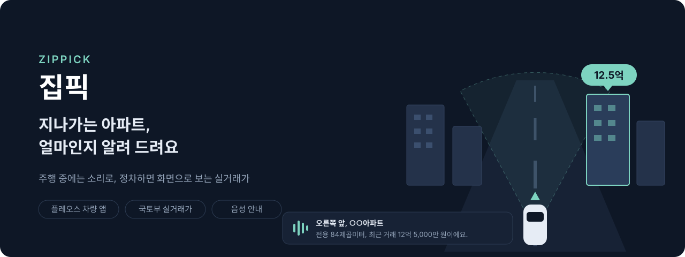
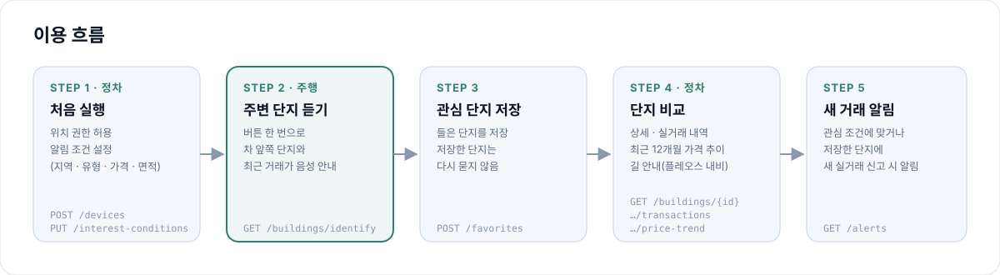
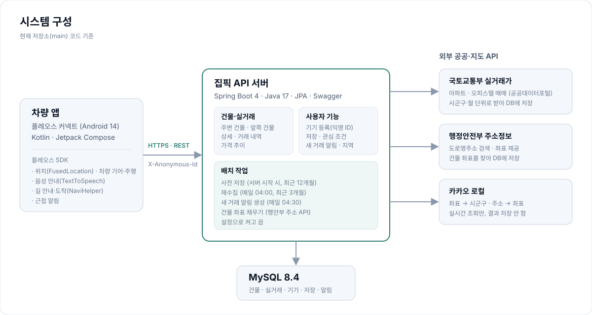

<p align="center">
  
</p>

# 집픽 (Zippick) 백엔드

> 지나가는 아파트, 얼마인지 알려 드려요.
> 주행 중에는 소리로, 정차하면 화면으로 주변 단지의 최근 실거래가를 보여 주는 플레오스 차량 앱의 API 서버

- 팀: GooodHandleTruck
- 차량 앱 저장소: [frontend](https://github.com/GooodHandleTruck-Hyndai/frontend)
- 협업 규칙(브랜치·커밋·PR): [CONTRIBUTING.md](CONTRIBUTING.md)

> **개발 중인 프로젝트** — 아래 기능 상태 표 기준. APK·시연 영상은 준비 중

## 목차
1. [해결하려는 문제](#해결하려는-문제)
2. [핵심 기능](#핵심-기능)
3. [이용 흐름](#이용-흐름)
4. [앱 화면](#앱-화면)
5. [시스템 구성](#시스템-구성)
6. [API](#api)
7. [실행 방법](#실행-방법)
8. [개발자 가이드](#개발자-가이드)

---

## 해결하려는 문제

- 운전 중 "저 아파트 얼마지?" 싶어도 휴대폰으로 시세를 찾아볼 수 없음
- 부동산 앱은 단지 이름을 알아야 검색 가능, 지나가며 본 단지는 이름도 모르는 경우가 많음
- 정차 후 다시 찾으려 해도 어느 단지였는지 기억나지 않음

**대상 사용자**
- 이사·매매를 알아보며 출퇴근·주말 운전 중 관심 지역을 지나는 운전자
- 손과 눈을 쓰지 않고 차 안에서 시세를 확인하고 싶은 사용자

**집픽의 방식**
- 주행 중: 버튼 한 번 → 차 앞쪽 단지와 최근 거래가를 음성으로 안내
- 정차 중: 주변 단지 지도·목록, 상세, 실거래 내역, 가격 추이를 화면으로 확인
- 관심 단지 저장 → 새 실거래가 신고되면 알림
- 데이터 출처: 국토교통부 실거래가 공개 자료(공공데이터포털)

---

## 핵심 기능

상태 기준: 이 저장소(main)와 [차량 앱 저장소](https://github.com/GooodHandleTruck-Hyndai/frontend) 기준. 바뀌면 이 표만 고치면 됨

| 기능 | 내용 | 서버 | 차량 앱 |
|---|---|---|---|
| 주변 단지 | 현재 위치 반경 안 건물과 최근 거래가 | 구현 완료 | 화면 구현, 서버 연동 개발 중 |
| 앞쪽 단지 음성 안내 | 진행 방향 좌우 90°·1km 안 가까운 건물 최대 3개 + 안내 문장 | 구현 완료 | 음성 안내 구현(앱 내 계산), 서버 API 연동 예정 |
| 단지 상세 | 단지 정보, 최근 거래 3건, 저장 여부 | 구현 완료 | 화면 구현, 서버 연동 개발 중 |
| 실거래 내역 | 해제 거래 제외, 최신순 더보기 | 구현 완료 | 화면 구현, 서버 연동 개발 중 |
| 가격 추이 | 이번 달 포함 최근 12개월 월별 평균 | 구현 완료 | 연동 예정 |
| 관심 단지 저장 | 저장·목록·취소 | 구현 완료 | 화면 구현, 서버 연동 개발 중 |
| 관심 조건 | 지역·유형·가격·면적 | 구현 완료 | 화면 구현, 서버 연동 개발 중 |
| 새 거래 알림 | 조건에 맞거나 저장한 단지의 새 실거래 → 알림 | 구현 완료(매일 배치) | 알림함 화면 개발 중 |
| 길 안내 | 단지를 플레오스 내비 목적지로 | — | 구현(플레오스 NaviHelper) |
| 실거래 데이터 | 아파트·오피스텔 매매 수집, 매일 재수집 | 구현 완료 | — |
| 원룸(연립다세대) 실거래 | 원룸 유형 추가 | 개발 중 | 예정 |
| AI 필터 | — | 예정(명세 작성 전) | 예정 |
| 단지 사진 | 응답에 `imageUrl` 칸만 있음(현재 항상 비어 있음) | 예정(출처 미정) | 기본 이미지 표시 |

시연 지역: 서울 마포구 (설정 `zippick.collect.sgg-cds`로 변경 가능)

---

## 이용 흐름

<p align="center">
  
</p>

1. **처음 실행(정차)** — 위치 권한, 알림 조건 설정. 앱이 익명 ID로 기기 등록(로그인 없음)
2. **주행 중** — [주변 단지 듣기] → 차 앞쪽 단지와 최근 거래가 음성 안내
3. **저장** — 들은 단지를 관심 단지로 저장
4. **정차 후** — 상세, 실거래 내역, 가격 추이 비교, 플레오스 내비로 길 안내
5. **새 거래 알림** — 조건에 맞거나 저장한 단지에 새 실거래가 신고되면 알림

---

## 앱 화면

> 화면 캡처 준비 중. 캡처를 `docs/assets/screens/` 에 넣고 아래 표의 칸만 이미지로 바꾸면 됨

| 화면 | 이름 | 설명 | 캡처 |
|---|---|---|---|
| S-01 | 시작하기 | 서비스 소개, 위치 권한 | 준비 중 |
| S-02 | 알림 조건 | 지역·유형·가격·면적 선택 | 준비 중 |
| S-03 | 주변 단지 | 약도와 가격 말풍선, 목록·정렬 | 준비 중 |
| S-04 | 단지 상세 | 평형별 가격, 거래 내역, 저장, 길 안내 | 준비 중 |
| S-05 | 저장한 단지 | 저장 순·거리 순·가격 순 | 준비 중 |
| S-06 | 기록 | 오늘 들은 단지 | 준비 중 |
| S-07 | 설정 | 주행 중 음성 알림 켜기·끄기, 알림 조건, 주변 범위 기본값 | 준비 중 |
| S-08 | 주행 중 | [주변 단지 듣기] | 준비 중 |
| S-09 | 주행 중 안내 | 음성 안내 중인 단지 | 준비 중 |
| S-10 | 새 거래 알림 | 저장한 단지의 새 거래 | 개발 중 |

<!-- 캡처 넣는 예시
| S-03 | 주변 단지 | 약도와 가격 말풍선 |  |
-->

---

## 시스템 구성

<p align="center">
  
</p>

| 구분 | 기술 |
|---|---|
| 서버 | Java 17, Spring Boot 4.0, Spring Data JPA, springdoc(Swagger) |
| DB | MySQL 8.4 (테스트는 H2 메모리 DB) |
| 외부 데이터 | 국토교통부 실거래가(아파트·오피스텔 매매), 행정안전부 도로명주소·좌표, 카카오 로컬 |
| 차량 앱 | Kotlin, Jetpack Compose, 플레오스 커넥트(Android 14), 플레오스 SDK |
| CI | GitHub Actions — PR·main 마다 `./gradlew build` |

**데이터 처리 원칙**
- 실거래: 국토부 자료를 시군구·월 단위로 받아 저장, 매일 04:00 최근 3개월 재수집(신고 지연·해제 반영)
- 해제 거래: DB에는 보관, 화면 응답(최근 거래·내역·추이·알림)에서는 제외
- 좌표: 행안부 좌표는 DB 저장, 카카오 좌표는 정책상 저장하지 않고 실시간 조회만
- 사용자 구분: 로그인 없이 앱이 만든 익명 ID(`X-Anonymous-Id` 헤더)

---

## API

전체 명세: 서버 실행 후 Swagger — `http://localhost:8080/swagger-ui.html`

| 메서드 | 경로 | 설명 |
|---|---|---|
| GET | `/health` | 서버 상태 |
| POST | `/api/v1/devices` | 기기 등록(익명 ID 발급) |
| GET | `/api/v1/devices/me` | 내 기기 확인 |
| GET | `/api/v1/regions` | 위치 → 시군구 코드 |
| GET | `/api/v1/buildings/nearby` | 주변 건물 |
| GET | `/api/v1/buildings/identify` | 앞쪽 건물 찾기 + 안내 문장 |
| GET | `/api/v1/buildings/{buildingId}` | 건물 상세 |
| GET | `/api/v1/buildings/{buildingId}/transactions` | 실거래 내역(더보기) |
| GET | `/api/v1/buildings/{buildingId}/price-trend` | 가격 추이 |
| POST | `/api/v1/buildings/coordinates` | 건물 좌표 조회 |
| GET · POST | `/api/v1/favorites` | 저장 목록 · 저장 |
| DELETE | `/api/v1/favorites/{buildingId}` | 저장 취소 |
| GET · PUT | `/api/v1/interest-conditions` | 관심 조건 조회 · 저장 |
| GET | `/api/v1/alerts` | 새 거래 알림 목록 |
| PATCH | `/api/v1/alerts/{alertId}/read` | 알림 읽음 |

---

## 실행 방법

| 방법 | 상태 |
|---|---|
| 공개 서버 | 운영 중 (1차 심사 기간) — `https://3-37-254-181.sslip.io` ([/health](https://3-37-254-181.sslip.io/health), [Swagger](https://3-37-254-181.sslip.io/swagger-ui.html)) |
| Docker 한 번에 실행 (키 없이, 마포 시연 데이터 포함) | 사용 가능 — [아래](#docker-로-한-번에-실행) |
| 로컬 개발 실행 (IntelliJ) | 사용 가능 — [개발자 가이드](#로컬-실행-intellij) |
| 차량 앱 APK | 준비 중 |
| 시연 영상 | 준비 중 |

### Docker 로 한 번에 실행

필요: Docker Desktop (JDK·IntelliJ·API 키 불필요)

```bash
docker compose -f compose.e2e.yaml up --build -d   # MySQL + 서버 + 마포 시연 데이터 (첫 실행은 이미지 빌드 3~5분)
./scripts/e2e-smoke.sh                             # 앱 사용 흐름 13개 자동 점검 (Windows 는 Git Bash)
docker compose -f compose.e2e.yaml down -v         # 끄기 + 데이터 삭제
```

- 확인: http://localhost:8080/health , http://localhost:8080/swagger-ui.html
- 안드로이드 에뮬레이터 앱(디버그 APK): `http://10.0.2.2:8080` = 이 PC 의 `localhost:8080` 으로 바로 연결
- 데이터: `e2e/seed/01-zippick.sql` (마포구 건물·실거래, 국토교통부·행정안전부 공공데이터)
- 카카오 키(선택): 레포 폴더에 `.env` 파일 생성 후 `KAKAO_REST_API_KEY=...` 추가 → 지역 찾기·좌표 없는 건물에 카카오 사용
  - 키 없으면: 지역은 DB(가장 가까운 건물의 구·동)로 대체, 행안부 좌표가 없는 일부 건물은 지도에서 제외
- 개발용 `compose.yaml` 과 프로젝트 이름·볼륨이 분리돼 서로 영향 없음. 8080 포트를 쓰는 다른 서버는 먼저 종료

**API 키**(환경 변수 또는 `.env`, 저장소에 올리지 않음)
- `MOLIT_SERVICE_KEY` — 국토부 실거래가(공공데이터포털)
- `KAKAO_REST_API_KEY` — 카카오 로컬
- `JUSO_SEARCH_KEY`, `JUSO_COORD_KEY` — 행안부 주소·좌표 (좌표 채우기 배치용)
- 수집·알림 배치는 기본 꺼짐: `ZIPPICK_PRELOAD_ENABLED`, `ZIPPICK_REFRESH_ENABLED`, `ZIPPICK_ALERT_ENABLED`, `ZIPPICK_JUSO_FILL_ENABLED` 를 `true` 로 켜기

---

## 개발자 가이드

### 로컬 실행 (IntelliJ)

#### 준비물
- **IntelliJ IDEA**
- **JDK 17**: 없으면 IntelliJ 에서 File → Project Structure → SDK → Download JDK → 17
- **Docker Desktop**: 로컬 MySQL 을 띄울 때 필요해요. 설치하고 **켜 둔 상태**여야 해요.

#### 실행
1. IntelliJ → **Open** → 이 폴더를 열고 Gradle Sync 가 끝날 때까지 기다려요.
2. `ZippickApplication` 을 실행(▶)해요.
   - Spring Boot 가 `compose.yaml` 의 MySQL 컨테이너를 **자동으로 띄워요.** DB 를 따로 설치할 필요가 없어요.
3. 브라우저에서 확인해요.
   - 서버 상태: http://localhost:8080/health → `{"status":"ok"}`
   - API 문서: http://localhost:8080/swagger-ui.html

#### 터미널로 실행하려면
```bash
./gradlew bootRun        # Windows PowerShell: .\gradlew.bat bootRun
./gradlew build          # 컴파일 + 테스트
```

#### 로컬 DB 접속 정보
| 항목 | 값 |
|---|---|
| Host | `localhost` |
| Port | `3307` (PC에 깔린 MySQL 과 안 겹치게) |
| Database | `zippick` |
| User / Password | `zippick` / `zippick` |

IntelliJ 의 Database 탭이나 DBeaver 로 붙어서 볼 수 있어요. 데이터는 Docker 볼륨에 남아서, 서버를 껐다 켜도 유지돼요.

### API 규칙

#### 공통 응답 형식
모든 API 는 `ApiResponse` 로 감싸서 응답해요. (`/health` 만 예외)

```json
// 성공
{ "success": true, "code": "OK", "message": "요청 성공", "data": { "id": 1 } }

// 실패
{ "success": false, "code": "C001", "message": "name: 비어 있을 수 없습니다" }
```

```java
@GetMapping("/buildings/{buildingId}")
public ApiResponse<BuildingResponse> getBuilding(@PathVariable String buildingId) {
    return ApiResponse.ok(buildingService.getBuilding(buildingId));
}
```

#### 에러 처리
서비스에서 예외를 던지기만 하면, `GlobalExceptionHandler` 가 알맞은 상태 코드와 실패 응답으로 바꿔줘요.
```java
throw new BusinessException(ErrorCode.NOT_FOUND);
```
새 에러가 필요하면 `ErrorCode` 에 추가해요. 공통 에러는 `C`, 도메인 에러는 도메인마다 앞 글자를 정해요(예: 저장 `F001`).

| 상황 | HTTP 상태 | code |
|---|---|---|
| `@Valid` 검증 실패 | 400 | C001 |
| 없는 경로 / 리소스 | 404 | C002 |
| 지원하지 않는 메서드 | 405 | C003 |
| 예상 못 한 서버 오류 | 500 | C999 |


### 폴더 구조

```
src/main/java/com/gooodhandletruck/zippick/
├── ZippickApplication.java
├── global/
│   ├── response/ApiResponse.java          공통 응답 형식
│   ├── error/                             ErrorCode, BusinessException, GlobalExceptionHandler
│   ├── config/                            Swagger, JPA Auditing 설정
│   └── entity/BaseTimeEntity.java         createdAt / updatedAt 자동 기록
├── health/HealthController.java           GET /health (앱 연결 확인용)
└── domain/                                기능별 패키지 (package-info.java 참고)

src/main/resources/
├── application.yml                        공통 설정
└── application-local.yml                  로컬 개발용 (MySQL 3307)
src/test/resources/application.yml         테스트용 (H2 메모리 DB)
compose.yaml                               로컬 MySQL 컨테이너
```
